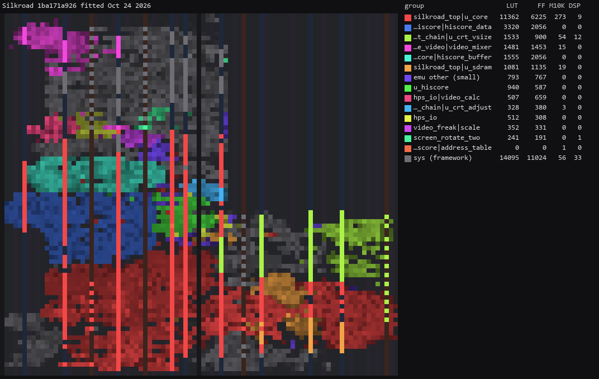
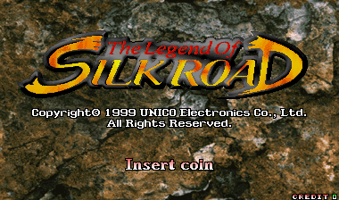
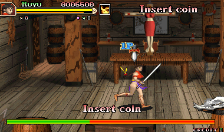
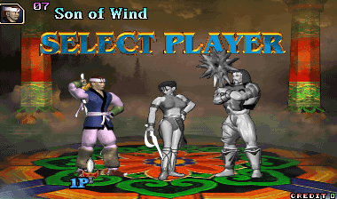
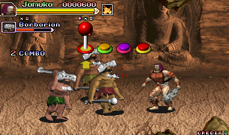
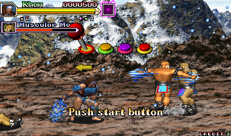
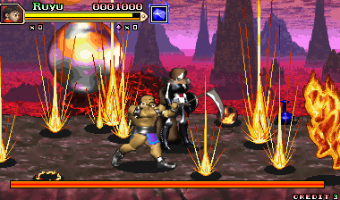

# Unico SR2001A (The Legend of Silkroad) core for MiSTer

A MiSTer FPGA core for Unico's SR2001A arcade board, The Legend of Silkroad (MAME's
`unico/silkroad.cpp`), built with Quartus Prime 17.0.2 Lite for the DE10-nano.

**Status: first release, `Arcade-Silkroad_20261024.rbf`. Both sets boot and play on a DE10-nano,
the video matching MAME's frames. The sound matches MAME's in a bench; it has not been judged by
ear on hardware.**

## Contents

- [History](#history)
- [Games](#games)
  - [Supported](#supported)
  - [Not yet](#not-yet)
  - [Out of scope for now](#out-of-scope-for-now)
- [Hardware](#hardware)
  - [Video timing](#video-timing)
  - [Floorplan](#floorplan)
- [Screenshots](#screenshots)
- [Installation](#installation)
- [Controls](#controls)
- [Status](#status)
  - [Features](#features)
  - [Todo](#todo)
  - [Resource usage](#resource-usage)
- [AI Attestation](#ai-attestation)
- [Verification](#verification)
- [Acknowledgements](#acknowledgements)
- [Layout](#layout)
- [License](#license)

## History

**20261024**
- First release

## Games

Both of MAME's sets of the one game; a 32 MB SDRAM module holds their 27 MB image. The two sets
hold the same data in different ROM sizes.

### Supported

Sets with an `.mra` in `releases/`, the clone in `releases/_alternatives/`.

| Name | Year | Manufacturer | MAME set | Notes |
|-|-|-|-|-|
| The Legend of Silkroad | 1999 | Unico | silkroad | |
| The Legend of Silkroad (larger ROMs) | 1999 | Unico | silkroada | the same image from three 4 MB sprite ROMs |

### Not yet

In-scope sets the RTL does not take yet, and why: none.

### Out of scope for now

None: the driver has these two sets.

## Hardware

| Chip | Function | Status |
|-|-|-|
| MC68EC020 16 MHz | main CPU | TG68K.C, vendored via the DreamWorld and Psikyo cores; the boot matches MAME's bus trace (Verification) |
| 2 x Actel A40MX04 | three tilemaps, sprites | written here from `silkroad.cpp`; identical to MAME's frames in simulation |
| YM2151 3.579545 MHz | FM, stereo | jt51; with the OKIs, correlation 0.912 with MAME's output over a second of play (Verification) |
| 2 x OKI M6295 1 and 2 MHz | ADPCM | jt6295, OKI 1 banked; mixed into both sides as MAME does |

### Video timing

8 MHz dot clock (32 MHz / 4), 512 dots a line, 262 lines: 15.625 kHz, 59.637 Hz, 380 x 224
shown. MAME has no raw timing for this board (60 Hz, a 512 x 256 bitmap); these numbers are a
choice, not a measurement (`docs/HACKS.md`).

### Floorplan

Where the logic sits on the Cyclone V, read from the compiled design with
`scripts/floorplan.py` (blocks defined in `scripts/floorplan.json`). One cell per LAB, M10K or DSP
site, coloured by the block owning most of it, brighter when fuller. The thin columns are M10K and
DSP; the empty area at the top right is the HPS; grey is the MiSTer framework. LUT counts are
combinational cells, two per ALM.

The release revision at `1ba171a`; per-block counts in `docs/floorplan/Silkroad_groups.md`.

## Screenshots

From a DE10-nano, native resolution. The first two (`3982a3c`) are identical to or within the
blinking text of a MAME frame; the others are from play.

## Installation

A 32 MB SDRAM module is required.

* Take the latest `*.rbf` from `releases/` and put it in `_Arcade/cores`, renamed to drop the
  `Arcade-` prefix (`Arcade-Silkroad_YYYYMMDD.rbf` becomes `Silkroad_YYYYMMDD.rbf`). MiSTer launches
  the highest-sorting match for `<rbf>Silkroad</rbf>`, and a `Silkroad_*.rbf` sorts above every
  `Arcade-Silkroad_*.rbf`
* Take the `*.mra` files and the `_alternatives` folder from `releases/` and put them in `_Arcade`
  (or a subdirectory starting with an underscore, e.g. `_Arcade/_Silkroad`)
* Put the MAME merged or split ROM sets in `games/mame`

To run a development build instead: `python scripts/build_staged.py`, then `python scripts/deploy.py`
with a `mister.env` (see `scripts/deploy.py`).

## Controls

Two players, an 8-way stick and three buttons each: **Attack**, **Jump**, **Select Magic** (named
from what each does in MAME; no manual or flyer was found).
Start, Coin, Pause (suspends the CPU) and Service (the test switch) have their own buttons.

Keyboard, MAME's defaults: arrows / R F D G, buttons LCtrl LAlt Space / A S Q, Start 1 / 2,
Coin 5 / 6; F2 the test switch, 9 / 0 service coins, P pause.

## Status

Known issues:

- The sound has not been judged by ear on hardware.
- The pixel clock (8 MHz, 512 x 262) and the SDRAM clock's phase are choices, not measurements
  (`docs/HACKS.md`).

`docs/MAME_KLUDGES.md` lists what is taken from MAME as behaviour and what is known not to be
right. `docs/HACKS.md` lists this core's own approximations. `docs/ROADMAP.md` is the plan and its
progress; `docs/LESSONS_LEARNED.md` is what it cost.

### Features

<!-- Keep every line; mark each done / not yet / n-a so the gaps are visible. -->

* DIP switches from the `.mra` (`DIP;` in the OSD): done; the defaults reach the game on hardware (its own Dip Switches page)
* Inputs: done; coin, Start, Button 1 and the test switch checked from the keyboard on hardware
* CRT Adjust (H-Position, V-Shift, H-Size, V-Size): from the DreamWorld core, not checked here
* HDMI scaling (integer scale, crop, crop offset): from the DreamWorld core, not checked here
* HDMI rotation (orientation): from the DreamWorld core, not checked here
* Flip screen, HDMI and analog, from the OSD or the fake DIP: done; through the fake DIP on
  hardware, the picture turned back matches MAME's frames; the OSD option not checked on hardware.
  The OSD option and the DIP together flip twice and cancel
* HDMI-only options hidden under direct video: done
* Peripheral menus shown only for games that use them: n/a (none)
* Rotary joysticks: n/a
* Light guns: n/a
* Audio mix (Mono, None, 25%, 50%): wired, not checked on hardware
* Hiscore saving (`hiscore.v`, with autosave): wired, MAME's hiscore.dat entry in the `.mra`; not checked on hardware
* NVRAM / EEPROM saved to the `.nvm` file: n/a (the board has none)
* Fast ROM loading via DDR: done (from the DreamWorld core)
* Pause (with CPU suspended): done, checked on hardware
* Sound: done, the YM2151 in stereo and both OKIs; checked against MAME in a bench
* Savestates (optional): not yet
* Cheats (optional): not yet

### Todo

- [x] Hardware check of the video: attract matched to MAME frames, flip, Pause, test switch
- [x] YM2151 (Phase 4), against MAME in a bench
- [ ] The sound judged by ear on hardware
- [ ] From the OSD on hardware: flip, DIP changes, service coins, hiscore, CRT Adjust, scaling

### Resource usage

The release revision `Silkroad` at `1ba171a`, default seed, on the DE10-nano's Cyclone V
5CSEBA6, speed grade 7. Timing met on every clock: `clk_sys` (48 MHz) +4.068 ns, `clk_sdram`
(96 MHz) +2.341 ns.

| resource | used | available |
| --- | --- | --- |
| Logic (ALMs) | 21,222 | 41,910 |
| RAM blocks | 421 | 553 |
| DSP blocks | 55 | 112 |

RAM blocks are the one to watch: 76% used.

## AI Attestation

This core is being developed with heavy use of a frontier coding assistant.
<!-- The author's familiarity with the platform and games: to be written by the author. -->

## Verification

Not PCB-validated. MAME is the accuracy reference, with its own acknowledged uncertainties noted
where they matter.

* CPU: from reset through MAME's first 2,000,000 bus accesses (seven frames), 74,256 of 74,256
  writes and 14,242 of 14,242 I/O reads match MAME's trace (`sim/boot_tb`).
* Video model: `scripts/render_model.py`, 26 of 26 scenes pixel-identical to MAME's frames.
* Video RTL: 13 of 13 scenes, two frames each, identical to the model through the real SDRAM path
  (`sim/frame_tb`); 2 scenes flipped, identical to the model turned 180 degrees.
* Graphics layout: `scripts/gfx_layout_check.py`, 0 of 1,049,344 pixels differ from MAME's decode.
* `.mra`: each set's image re-read byte for byte against one built from `ROM_START`.
* Sound: MAME's writes to the YM2151, both OKIs and the bank register replayed through the RTL
  and the real SDRAM path (`sim/snd_trace_tb`): over 30-31 s of play, correlation 0.912 with
  MAME's output on each side, level 0.983 of MAME's.
* Per-line fetch budget on hardware: 0 tilemap and 0 sprite lines cut short in 88,443 frames of
  attract and play, worst line 2,152 of 3,072 clk (ISSP counters, `Silkroad_30000006`).

## Acknowledgements

- **Sorgelig** and the **MiSTer-devel team** for the
  [Template_MiSTer](https://github.com/MiSTer-devel/Template_MiSTer) framework, the SDRAM controller
  and the screen rotator.
- The **MAMEdev team** — David Haywood and R. Belmont — for `silkroad.cpp` and the device emulations
  that are this core's specification.
- **Tobias Gubener** for [TG68K.C](https://github.com/TobiFlex/TG68K.C) (LGPL-3.0).
- **Jose Tejada (jotego)** for [jt51](https://github.com/jotego/jt51) and
  [jt6295](https://github.com/jotego/jt6295) (GPL-3.0).
- **Alan Steremberg** and **Jim Gregory** for [Hiscores_MiSTer](https://github.com/JimmyStones/Hiscores_MiSTer).
- **rmonic79** for CRT Adjust.

## Layout

Standard [Template_MiSTer](https://github.com/MiSTer-devel/Template_MiSTer) structure:

| path | contents |
| - | - |
| `sys` | MiSTer framework, vendored from the template, never edited |
| `rtl` | core source; vendored modules carry a `PROVENANCE.md` |
| `releases` | `.rbf` and `.mra` files; clones in `_alternatives` |
| `docs` | roadmap, workflow, release process, kludges, hacks, lessons |
| `sim` | ModelSim and Verilator testbenches |
| `scripts` | build, deploy, capture and verification tooling |
| `debug` | reference captures from MAME used as ground truth (gitignored) |
| `roms` | your own MAME sets (gitignored, never committed) |

## License

GPL-3.0-or-later (see `LICENSE`). Imported components keep their own licences; `THIRD-PARTY.md` has the
detail and every modified vendored file states the change in its header.

Game ROMs contain copyrighted material and are not included. Obtaining them is your
responsibility.
